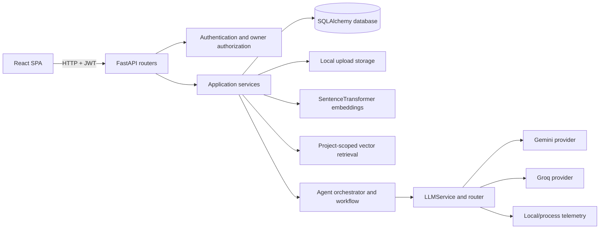
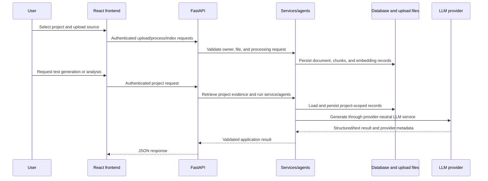
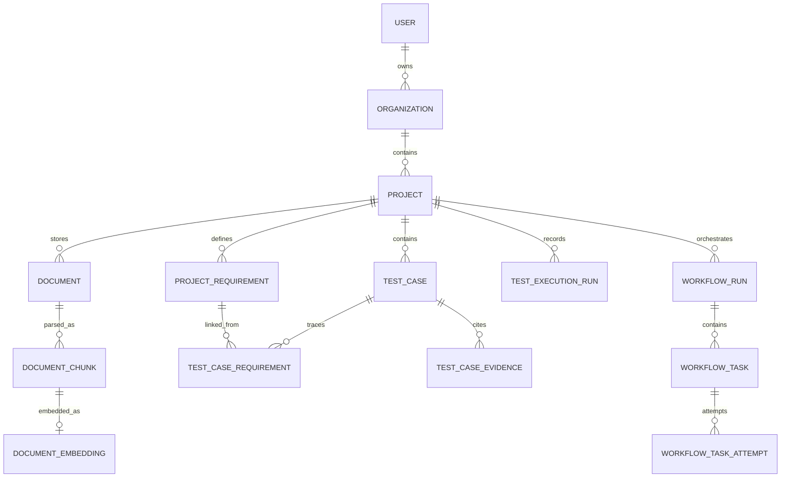

# TestNova Product and Technical Inventory

## Scope and evidence

This inventory describes the repository's statically inspected implementation.
It is not a runtime certification: no application, database, external provider,
or test suite was run for this document. The inventory excludes generated
artifacts, dependencies, caches, uploaded content, and environment-file
contents. Statuses below describe evidence in source, not production
availability.

Snapshot counts from source:

- 54 API-router handlers, plus the root `GET /` health handler.
- 19 SQLAlchemy table models.
- 8 specialized agent classes, in addition to the base agent and orchestrator.
- 9 named frontend routes (login and eight authenticated pages).
- 42 backend test modules and 4 frontend test files.

## A. Product summary

TestNova is a project-scoped AI quality-engineering application. Its implemented
workflow combines uploaded product documents, semantic retrieval, AI-assisted
requirements analysis and test-case generation, human review/approval,
configured API test execution, and analytics. The main entry points are the
React single-page application and the FastAPI backend.

## B. Product capabilities and maturity

| Capability | Status | Evidence and scope |
|---|---|---|
| Account registration and login | Implemented | Password-based auth, JWT dependency, and authenticated frontend shell. |
| Projects | Implemented | Owner-scoped project create/list/update/delete and dashboard endpoints. |
| Document ingestion and project knowledge | Implemented | Local upload, parsing/chunking, embeddings, and project-filtered semantic search. |
| AI test-case generation | Implemented | Generation service persists structured test cases, requirement/evidence links, and generation-run records. |
| Test-case evaluation and review | Implemented, advisory | Structural and evidence checks plus semantic evaluation; automatic approval is explicitly avoided. |
| Configured API execution | Implemented with restrictions | Approved cases only; HTTPS and host allowlist checks; persisted execution runs. |
| Workflows | Implemented | Persisted task graph, attempts, background execution, and resume endpoint for recoverable states. |
| Quality analytics | Implemented | Project overview, document metrics, test-case distributions, requirement traceability, execution summaries, and trends. |
| Risk insights and AI quality summaries | Implemented as evidence-backed insights | Risk/workflow analytics and generated summary endpoints; not a substitute for human validation. |
| Release-readiness review | Implemented as an explainable assessment | Composes existing evidence into concerns and next actions; does not establish a release guarantee. |
| LLM benchmark/evaluation | Implemented as an explicit offline/live CLI workflow | Versioned synthetic dataset, deterministic scoring proxies, optional live provider runs, and local reports. |
| Production recovery | Partial | Local-upload backup/verify/restore tooling exists; provider-managed database recovery remains outside the application implementation. |

## C. Architecture at a glance

The backend is organized under `backend/app/` into API routers, core
configuration/authentication, SQLAlchemy models, Pydantic schemas, agents,
provider-neutral LLM code, and services. The frontend is a React SPA built with
Vite, React Router, Axios, Tailwind, and Recharts. The database layer uses
SQLAlchemy and PostgreSQL/pgvector-related dependencies; embeddings are
384-dimensional.

## D. Main request and data flows

Upload, parsing, embedding, generation, and execution are distinct operations.
The frontend upload helper chains upload, document processing, and embedding
requests; this is not a single database transaction across the full chain.
Search requires a project-owned document/embedding path and filters results by
project.

## E. Frontend pages and integration

`frontend/src/App.jsx` defines the named routes below. All pages other than
`/login` are inside the authenticated application shell; unknown routes redirect
to `/`.

| Route | Page | Primary responsibility |
|---|---|---|
| `/login` | `AuthPage.jsx` | Login and registration forms. |
| `/` | `DashboardPage.jsx` | Project-oriented dashboard and overview. |
| `/projects` | `ProjectsPage.jsx` | Project selection and management. |
| `/upload` | `UploadPage.jsx` | Upload and document management. |
| `/test-cases` | `TestCasesPage.jsx` | Test-case generation, review, management, and execution interactions. |
| `/workflows` | `WorkflowsPage.jsx` | Workflow status, tasks, attempts, and recovery actions. |
| `/analytics` | `AnalyticsPage.jsx` | Document, case, traceability, execution, risk, and workflow analytics; quality-summary action. |
| `/release-readiness` | `ReleaseReadinessPage.jsx` | Release-readiness concerns and supporting evidence. |
| `/assistant` | `AssistantPage.jsx` | Project knowledge chat and persisted conversation history. |

`frontend/src/api/client.js` centralizes Axios configuration and bearer-token
attachment, and normalizes unauthorized responses through the shared error
handling path. `frontend/src/api/projects.js` contains project, analytics,
document, and test-case requests. The UI uses Recharts; analytics uses separate
visualizations for execution counts and pass-rate trends.

## F. Backend API inventory

The following table contains all statically discovered API-router paths.
Unless noted, project and user data routes require an authenticated user and
apply project ownership checks directly or through their service. `/auth`
registration and login are public. Response envelopes vary between routers;
clients should use the specific route's implementation rather than assume one
universal envelope. The method/path column is relative to the router prefix in
the first column.

| Router prefix | Method and path | Purpose / notable inputs |
|---|---|---|
| `/auth` | `POST /register` | Create account; request body is `UserCreate`. Public. |
| `/auth` | `POST /login` | Authenticate; request body is `UserLogin`. Public. |
| `/projects` | `POST /` | Create project from `ProjectCreate`. |
| `/projects` | `GET /` | List current user's projects. |
| `/projects` | `PUT /{project_id}` | Update an owned project. |
| `/projects` | `DELETE /{project_id}` | Delete an owned project. |
| `/projects` | `GET /{project_id}/dashboard` | Project dashboard data. |
| `/dashboard` | `GET /` | Current-user dashboard. |
| `/dashboard` | `GET /insights` | Current-user dashboard insights. |
| `/uploads` | `POST /` | Upload a project document; `project_id`, file, and `source_type`. |
| `/uploads` | `GET /project/{project_id}` | List project documents. |
| `/uploads` | `DELETE /{document_id}` | Delete an owned document. |
| `/documents` | `POST /{document_id}/process` | Parse document and persist chunks. |
| `/embeddings` | `POST /regenerate` | Generate/regenerate project embeddings; project/document identifiers. |
| `/projects/{project_id}/knowledge-base` | `POST /index` | Return project knowledge-base index counts/readiness. |
| `/projects/{project_id}/knowledge-base` | `GET` | Semantic document search; `query`, optional `limit`, optional source types. |
| `/projects` | `POST /{project_id}/knowledge/search` | Request-shaped project knowledge search. |
| `/retrieval` | `GET /context` | Retrieve project context; project ID, query, optional limit/source types. |
| `/chat` | `POST /sessions` | Create project chat session; `project_id`. |
| `/chat` | `GET /sessions` | List current user's project sessions; `project_id`. |
| `/chat` | `GET /sessions/{session_id}` | Fetch session messages; `project_id`. |
| `/chat` | `DELETE /sessions/{session_id}` | Delete session; `project_id`. |
| `/chat` | `POST /` | Ask project-context question; `session_id`, `project_id`, `question`. |
| `/projects` | `GET /{project_id}/test-cases` | List cases; `limit` is bounded. |
| `/projects` | `GET /{project_id}/test-cases/{test_case_id}` | Fetch case and verified evidence. |
| `/projects` | `PATCH /{project_id}/test-cases/{test_case_id}` | Update a case using `TestCaseUpdate`. |
| `/projects` | `DELETE /{project_id}/test-cases/{test_case_id}` | Delete a case. |
| `/projects` | `GET /{project_id}/test-case-generation-runs` | List generation-run history. |
| `/projects` | `POST /{project_id}/test-cases/generate` | Generate test cases using `TestCaseGenerationRequest`. |
| `/projects` | `POST /{project_id}/test-cases/{test_case_id}/evaluate` | Evaluate a saved case. |
| `/projects` | `POST /{project_id}/test-case-generation-runs/{generation_run_id}/evaluate` | Evaluate a generation run. |
| `/projects` | `PATCH /{project_id}/test-cases/{test_case_id}/approve` | Approve a case through the explicit review flow. |
| `/projects` | `POST /{project_id}/change-risk/analyze` | Run change-risk analysis. |
| `/projects` | `POST /{project_id}/test-cases/{test_case_id}/review` | Run advisory review of a saved case. |
| `/projects` | `POST /{project_id}/test-analysis/analyze` | Analyze available execution history. |
| `/projects` | `POST /{project_id}/quality-insights/analyze` | Generate project quality insights. |
| `/projects` | `POST /{project_id}/test-cases/{test_case_id}/execute-api` | Execute configured API checks for a case. |
| `/projects` | `GET /{project_id}/test-executions` | Paginated execution history; `limit`, `offset`. |
| `/projects` | `GET /{project_id}/test-executions/{run_id}` | Fetch one execution run. |
| `/analytics` | `GET /overview/{project_id}` | Project document/chunk/embedding overview. |
| `/analytics` | `GET /documents/{project_id}` | Document-level chunk and embedding statistics. |
| `/analytics` | `GET /test-cases/{project_id}` | Test-case statistics and distributions. |
| `/analytics` | `GET /coverage/{project_id}` | Explicit/inferred requirement traceability. |
| `/analytics` | `GET /executions/{project_id}` | Run totals, status counts, and duration statistics; optional paired `from`/`to`. |
| `/analytics` | `GET /execution-trends/{project_id}` | Time-bucketed execution counts and pass rates; optional `from`, `to`, `bucket=day|week|month`. |
| `/analytics` | `GET /risks/{project_id}` | Project risk analytics from persisted workflow/execution evidence. |
| `/analytics` | `GET /workflows/{project_id}` | Workflow monitoring; optional bounded `limit`. |
| `/analytics` | `POST /quality-summary/{project_id}` | Generate validated quality summary. |
| `/analytics` | `GET /release-readiness/{project_id}` | Compose explainable release-readiness evidence and concerns. |
| `/projects` (workflow routes) | `POST /{project_id}/workflows` | Start a workflow from `WorkflowStartRequest`; accepted asynchronously. |
| `/projects` (workflow routes) | `GET /{project_id}/workflows` | List project workflows; bounded `limit`. |
| `/projects` (workflow routes) | `GET /{project_id}/workflows/{workflow_id}` | Fetch workflow and nested task/attempt details. |
| `/projects` (workflow routes) | `GET /{project_id}/workflows/{workflow_id}/tasks` | Fetch workflow tasks. |
| `/projects` (workflow routes) | `POST /{project_id}/workflows/{workflow_id}/resume` | Resume eligible failed or partial workflow. |
| `/` | `GET /` | Service health response. |

Rate limiting is applied to selected expensive or sensitive endpoints, including
authentication, uploads, chat, workflow start, test execution, selected
analytics, and knowledge search/index operations. Exact limits are defined in
the route decorators and `core/rate_limit.py`.

## G. Agents and orchestration

Agent contracts are defined in `backend/app/agents/contracts.py`. The
`Orchestrator` routes a task to its registered agent and normalizes unexpected
exceptions to failed `AgentResult`s. `WorkflowService` registers the workflow
agents; route-local orchestrators also register knowledge search and
generation as needed.

| Agent | Role | LLM/service connection |
|---|---|---|
| `KnowledgeAgent` | Project-scoped semantic retrieval. | Uses `RetrievalService`; no direct LLM call. |
| `RequirementsAnalysisAgent` | Extract explicit and inferred requirements, criteria, ambiguities, and risks from cited evidence. | Uses retrieval/knowledge agent and `LLMService`. |
| `TestGenerationAgent` | Generate and persist test cases. | Delegates to `TestCaseGenerationService`, which uses `LLMService`. |
| `ReviewAgent` | Review a saved case and produce findings/recommendations. | Delegates to `TestCaseEvaluationService`, which may use `LLMService`; human approval remains separate. |
| `ChangeRiskAgent` | Analyze change summary and project evidence. | Uses `RetrievalService` and `LLMService`. |
| `TestAnalysisAgent` | Analyze execution history and failures. | Uses `TestExecutionService` and `LLMService`. |
| `QualityInsightAgent` | Combine document and execution analytics into insights. | Uses `AnalyticsService`, `TestExecutionService`, and `LLMService`. |
| `BugAnalysisAgent` | Analyze bug reports, failed executions, requirements, and candidate cases. | Uses retrieval, execution history, database case lookup, and `LLMService`. |

`full_qa_workflow`, `test_generation`, `bug_analysis`,
`change_risk_analysis`, and `quality_insights` templates are defined in
`Orchestrator`. The workflow service persists runs, tasks, and attempts,
respects task dependencies, limits concurrency, and supports resuming eligible
states. Some specialized agent endpoints execute agent logic outside the
persisted workflow lifecycle; workflow monitoring therefore does not represent
every standalone agent request.

## H. Document ingestion and project knowledge

`uploads.py` validates supported file extensions and content types, filename,
content, size, and Office archive limits before storing files beneath the local
upload root. The accepted formats are TXT, CSV, JSON, PDF, DOCX, and XLSX.
`DocumentProcessingService` parses text, normalizes/chunks it, and stores
`DocumentChunk` rows with source metadata and available source locations.
Embedding generation uses `ModelService` with the SentenceTransformer
`all-MiniLM-L6-v2` model and stores 384-dimensional vectors.

`RetrievalService.search_project_context` first requires an owned project,
validates selected document IDs and source types, embeds the query, applies
project/model/similarity filters, and returns cited chunk and document metadata.
Search is database-backed vector retrieval, not a document-history endpoint.
Uploaded files are stored locally; this is distinct from database storage or a
managed object-storage service.

## I. Test-case generation and review

Generation inputs are validated by Pydantic schemas. The generation service
uses project evidence, validates structured output, checks references against
available evidence/requirements, and persists cases plus generation-run,
evidence, and requirement associations. Test cases have category,
priority/severity, review status, steps, and expected result.

Case evaluation checks record ownership, requirement links, evidence links,
structure, coverage observations, duplicates, and semantic support. Findings
are advisory; the review agent requires human approval and does not
automatically approve or reject. The generation dataset benchmark is separate
from project records and uses synthetic examples; it must not be interpreted as
real-project quality evidence.

## J. Test execution

`TestExecutionService` executes configured API requests only for approved cases
in an owned project. The target policy requires HTTPS, standard port, a
configured exact host allowlist, and public DNS/IP resolution. Request snapshots
and expected values are redacted before persistence. Each run is stored in
`TestExecutionRun` with status, HTTP result, duration, assertions, error, and
creation timestamp. Repeated runs are separate persisted events.

Execution is configured API checking, not a general browser or application
test-runner. The history endpoint is paginated; analytics aggregate stored runs
directly so they are not limited to a history page.

## K. Analytics, risk, and release review

`AnalyticsService` provides document metrics, test-case category/priority/review
distributions, requirement traceability, lifetime or date-filtered execution
summaries, and execution trends. Traceability distinguishes explicit from
inferred requirements, counts unique explicit requirements, excludes
cross-project links, and labels association metrics as traceability rather
than proof of complete testing. Execution statuses share normalization and
classification; missing and blank statuses are separate from unknown `other`.
Durations are included only when finite and non-negative; unavailable or
invalid durations are reported separately. Trends use UTC half-open intervals,
day/week/month buckets (Monday-start weeks), a 366-day maximum, and only
in-interval zero buckets.

`ProjectIntelligenceService` derives risk findings and workflow monitoring from
persisted workflow/execution evidence, then can ask an LLM for a quality
summary. `ReleaseReadinessService` composes metrics and evidence into named
concerns with attention levels, sources, evidence identifiers, and next actions.
These are not a validated release gate or an assurance that a release is safe.
There is no claim of defect-severity analytics based on test-case severity.

## L. LLM providers, routing, and structured output

`LLMService` is the provider-neutral generation entry point. Provider creation
and model selection are in `app/llm/providers/__init__.py`; supported providers
are Gemini and Groq. `LLMRouter` records a primary attempt and, when enabled,
tries the configured fallback only for rate-limit, timeout, and transient
provider API failures. It does not retry arbitrary invalid requests or
authentication failures. Provider SDK retry counts are disabled in the
adapters so routing behavior remains explicit.

Gemini and Groq adapters normalize errors and available token-usage metadata to
the shared LLM contracts. Structured output is schema-validated by
`validate_structured_output`; provider JSON mode alone is not treated as schema
validation. Primary and fallback configuration, generation limits, timeout,
pricing, and telemetry options are named in `core/config.py`. This inventory
does not disclose or inspect any configured credential values.

Direct `LLMService` call paths include chat, requirements analysis, test-case
generation, test-case evaluation, change-risk analysis, test analysis, quality
insight, bug analysis, and project quality-summary generation. Benchmark
execution constructs the same service with fallback disabled so provider runs
are attributable.

## M. LLM telemetry and evaluation

`app/llm/telemetry.py` records provider/model, timing, outcome, error
classification, attempt/fallback details, token observations, and optional
estimated cost. Cost is computed only when exact provider/model pricing and
currency are configured; it is an estimate, not an invoice. A bounded
in-memory service supplies summaries and recent records. The durable sink uses
local JSONL telemetry with configured rotation limits and avoids storing
prompts/responses. Telemetry is operationally local; it is not a database-backed
per-project model-performance dashboard.

`backend/evaluation_datasets/test_case_generation_v1.json` is the versioned
synthetic dataset. The benchmark separates JSON/schema validity, evidence
citation precision/recall and lexical-overlap proxies, requirement/category
coverage, unsupported-phrase detection, and deterministic usefulness heuristics.
The documentation explicitly requires human scoring for subjective usefulness
and semantic entailment. The benchmark CLI is offline by default and requires
an explicit `--live` option for external provider calls. Reports are local
artifacts, not application database records; mock measurements must not be
presented as live latency or cost.

## N. Persistent data model

The 19 SQLAlchemy models map to these tables. Key relations below are
source-level foreign-key/relationship structure; this list is not a schema
migration report.

| Model / table | Primary role and notable relations |
|---|---|
| `User` / `users` | Account identity and password/auth fields; organization ownership relation. |
| `Organization` / `organizations` | Owner-linked organizational container; relates to users and projects. |
| `Project` / `projects` | Belongs to an organization; project root for documents, requirements, workflows, and analytics. |
| `ProjecActivity` / `project_activities` | Project activity counters. Class spelling is `ProjecActivity` in source. |
| `Document` / `documents` | Project-owned uploaded-file metadata and uploader; parent of chunks. |
| `DocumentChunk` / `document_chunks` | Parsed content and source metadata; child of document, parent of embedding. |
| `DocumentEmbedding` / `document_embeddings` | Unique vector per chunk, model name, 384-dimension vector. |
| `ProjectRequirement` / `project_requirements` | Project requirement key, description, explicit/inferred classification, evidence IDs. |
| `TestCase` / `test_cases` | Project-owned case content, steps, category, priority, severity, status, optional generation run. |
| `TestCaseRequirement` / `test_case_requirements` | Association between test case and project requirement. |
| `TestCaseEvidence` / `test_case_evidence` | Case references to document and chunk evidence. |
| `TestCaseGenerationRun` / `test_case_generation_runs` | Generation attempt/output attribution, linked to project/user and optionally workflow. |
| `TestExecutionRun` / `test_execution_runs` | One persisted API run per attempt, with status, duration, assertions, and timestamp. |
| `WorkflowRun` / `workflow_runs` | Project workflow, type, status, input/output, lifecycle timestamps. |
| `WorkflowTask` / `workflow_tasks` | Workflow child task, dependencies, output, status, attempt count. |
| `WorkflowTaskAttempt` / `workflow_task_attempts` | Per-task attempt input/output, status, errors, and timestamps. |
| `ChatSession` / `chat_sessions` | User/project chat container. |
| `ChatHistory` / `chat_history` | User/project/session messages. |
| `SemanticCache` / `semantic_cache` | Project-scoped semantic cache records. |

The main persisted relations are:

## O. Authentication, authorization, and data boundaries

Authenticated API handlers use the `CurrentUser` dependency. The shared
`get_owned_project` check joins `Project` to `Organization` and compares the
organization owner ID to the current user; `get_owned_document` applies the
same ownership path for documents. Project-sensitive services and routes use
these checks before retrieval or mutation. Unknown/not-owned projects are
generally presented as not found to avoid exposing their existence.

The observed organization model is owner-based; this source inventory does not
find a general organization membership/role authorization system. The browser
stores an access token in local storage and sends it through the Axios request
interceptor. Upload and execution paths have additional validation and
rate-limiting controls. Production deployment still depends on correctly
configured secrets, origin restrictions, allowed execution hosts, and
provider/database settings.

## P. Configuration and operations

Configuration is declared in `backend/app/core/config.py`; names include
`DATABASE_URL`, `GEMINI_API_KEY`, `GROQ_API_KEY`, `JWT_SECRET_KEY`,
`LLM_PROVIDER`, provider/model/fallback settings, `LLM_PRICING`,
`LLM_TELEMETRY_PATH`, `LLM_TIMEOUT_SECONDS`, `MAX_UPLOAD_SIZE_BYTES`,
`CORS_ORIGINS`, `AUTO_CREATE_SCHEMA`, chunk/retrieval limits,
`CONTEXT_TOKEN_BUDGET`, and workflow concurrency/timeout controls.
`TEST_EXECUTION_ALLOWED_HOSTS` is read by the execution service. The frontend
uses `VITE_API_BASE_URL` with a local default.

`main.py` registers all routers, middleware, and exception handling. It invokes
`Base.metadata.create_all()` only when `AUTO_CREATE_SCHEMA` is enabled; this
inventory did not start the app or access the database. Deployment and schema
notes are in `docs/deployment.md` and
`docs/phase4-supabase-schema-mismatch.md`. Upload files are local filesystem
data. The backup utility backs up local uploads; it does not replace a
provider-managed database backup or validate a production recovery plan.

## Q. Test and validation inventory

Backend tests are under `backend/tests/` (42 `test_*.py` modules). They cover
auth, projects, document processing, retrieval, generation/review, analytics,
execution, workflows, LLM routing/providers/telemetry/benchmarking, security,
uploads, and offline recovery behavior. Frontend tests are under
`frontend/tests/` (workflow and release-readiness presentation, API error
handling, and unauthorized-response handling). A GitHub Actions workflow file
was not found in `.github/workflows/` during this inspection.

Tests were not executed as part of this inventory request. Before changing
behavior, choose only tests that isolate external systems; inspect fixture and
configuration behavior first, because backend settings can be loaded during
test collection. Benchmark `--live` execution, migrations, database-backed
tests, and application startup are not safe substitutes for offline validation.

## R. Current limitations and cautions

- No live-service or runtime behavior was verified during this inventory.
- Semantic search and model-generation quality depend on external providers,
  configuration, and evidence availability.
- Deterministic benchmark scores are proxies on a small synthetic dataset;
  they do not prove semantic support or real-world test usefulness.
- Token counts and pricing may be unavailable; estimated cost is conditional on
  configured rates and must not be treated as billed cost.
- The application has no database-backed benchmark history or general
  per-project LLM telemetry dashboard in the inspected implementation.
- Test execution is an allowlisted API-check mechanism, not a general test
  runner.
- Risk and release-readiness outputs are advisory evidence compositions, not
  a guarantee of release quality.
- Local upload backup does not demonstrate database backup/recovery or
  production disaster recovery.
- Project authorization is based on organization ownership; broader
  collaboration/role behavior is not established by the inspected models.

## S. Recommended preparation for future validation

1. Establish a safe, isolated test configuration with explicit fake
   providers and in-memory or temporary local fixtures; verify no test uses the
   configured database or live provider.
2. Maintain offline tests for owner-scoping and cross-project boundaries across
   every new project-facing endpoint.
3. Keep benchmark datasets immutable and versioned; require human review for
   semantic claims and usefulness conclusions.
4. Treat unavailable telemetry, missing durations, and empty histories as
   unavailable evidence, never measured success.
5. Add integration/deployment validation separately for managed database
   backups, recovery drills, production origins, allowlisted execution hosts,
   and provider credentials.
6. Preserve the separation between analytical evidence, advisory risk
   findings, and human release decisions.

## Source map

- Backend route registration and application setup: `backend/app/main.py`
- API routers: `backend/app/api/`
- Authentication and ownership checks: `backend/app/core/`
- Agents and contracts: `backend/app/agents/`
- LLM contracts, providers, routing, validation, and telemetry: `backend/app/llm/`
- Persistence models: `backend/app/models/`
- Application services: `backend/app/services/`
- Frontend routes: `frontend/src/App.jsx`
- Frontend API requests: `frontend/src/api/`
- Frontend page components: `frontend/src/pages/`
- Evaluation dataset and runner: `backend/evaluation_datasets/` and `backend/app/evaluation/`
- Deployment and evaluation guidance: `docs/deployment.md` and `docs/llm-evaluation.md`
